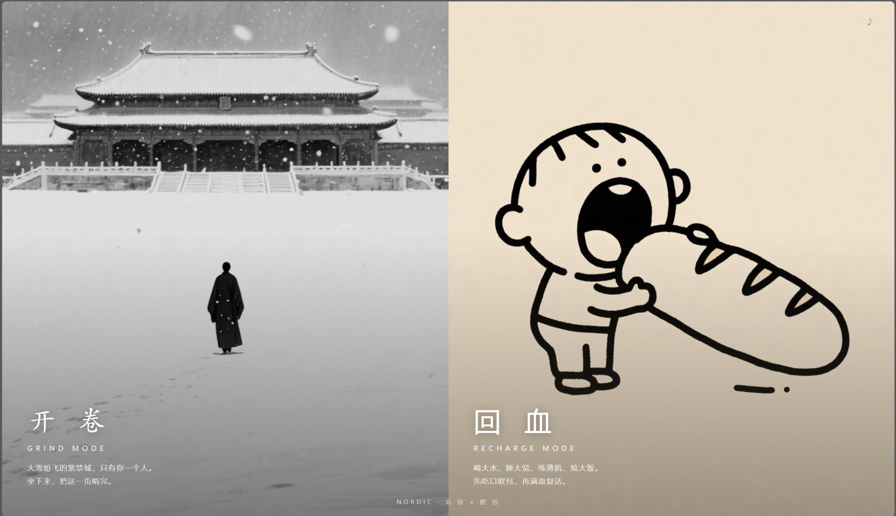
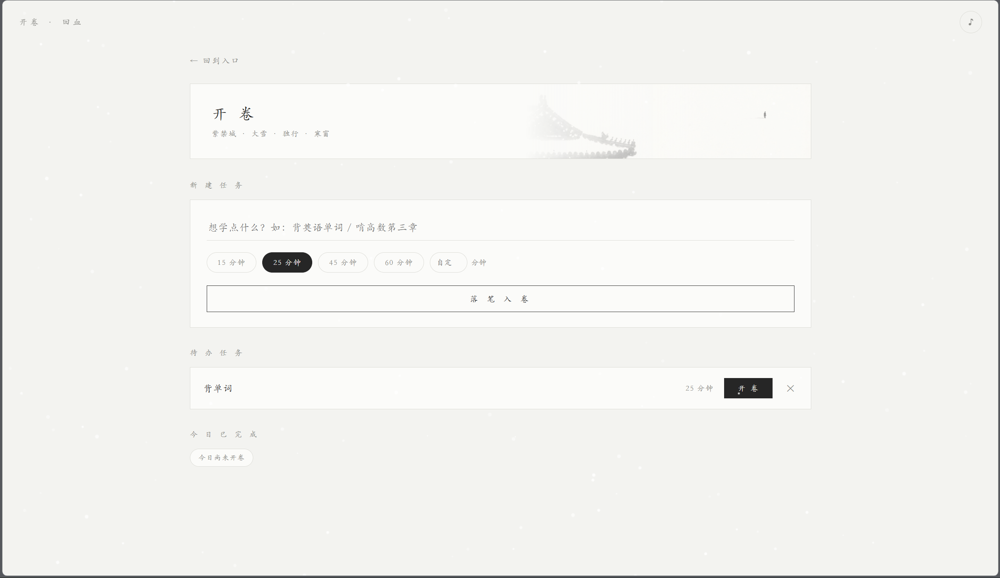
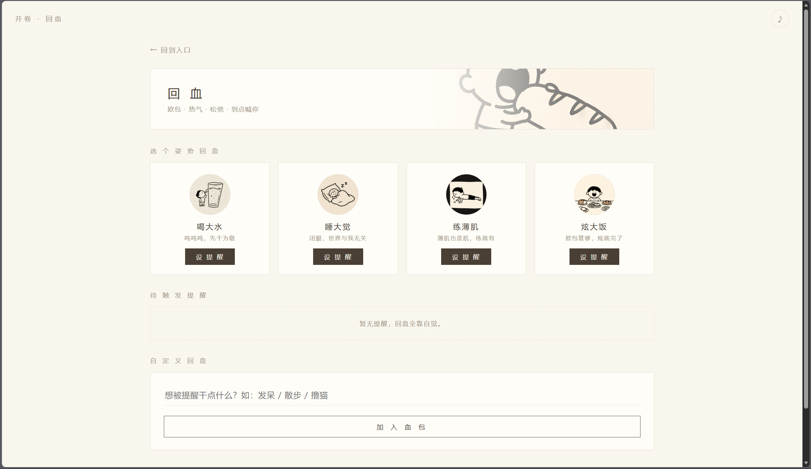
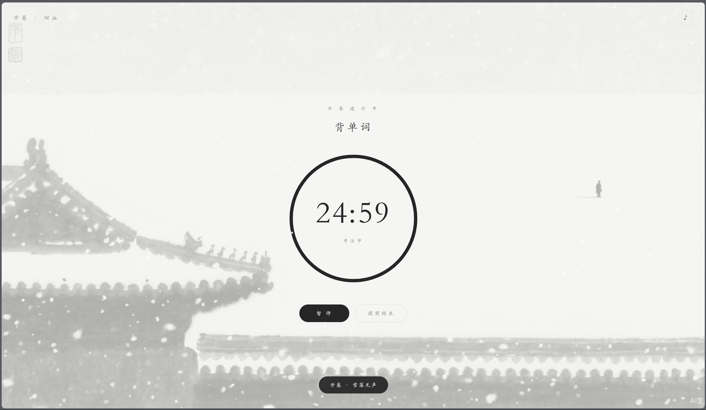
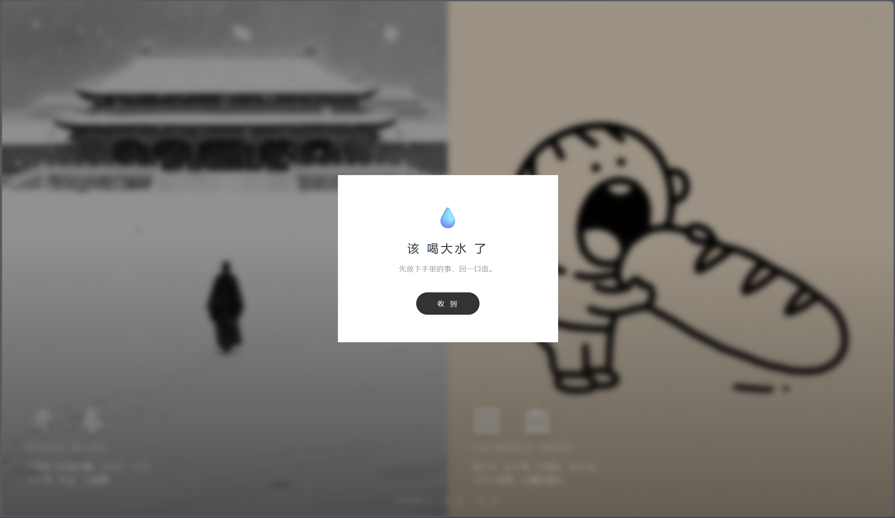

# 开卷 · 回血

> 北欧冷淡风双模倒计时小站 —— Trae 1024 盲盒作品

「北」是北京紫禁城的雪，「欧」是一只欧包。一词双扣，双面人生。

## 一句话简介

单文件双主题效率小站：「开卷」陪你在水墨大雪紫禁城里专注倒计时，「回血」以手绘欧包风定时提醒你喝水、睡觉、炫大饭。北（京）欧（包）冷淡风，一词双扣。

## 创作故事

「开卷 · 回血」诞生于 Trae 1024 盲盒的三个关键词：学习充电、倒计时器、北欧冷淡风。

拿到词后我一直在想：北欧冷淡风只能是一种视觉风格吗？后来我把它拆成了一个双关——「北」是北京，「欧」是欧包。

北，是下雪的紫禁城：红墙被雪洗成水墨，空旷的广场上只有一个独行的人。那是"学习"该有的样子——孤独、安静、专注。
欧，是欧包：奶油色、手绘小人张大口吃面包的松弛感。那是"充电"该有的样子——有梗、温暖、被照顾。

于是这个项目成了一张双面人生唱片：
A 面「开卷」是专注倒计时。水墨黑白灰、全程落雪动画、程序生成的古筝钟声氛围乐，把"再学 25 分钟"变成一件有仪式感的事。
B 面「回血」不是倒计时，而是定时提醒——喝水、睡觉、炫饭这些放松动作，不该被倒计时的紧张感绑架。设好"20 分钟后提醒我喝水"，到点网页弹窗喊你，还支持每小时循环。

整个作品是一个单 HTML 文件：无需安装、双击即用，数据存本地，插画由 AI 生成，音乐由 Web Audio 实时合成，零依赖、零构建。

它解决的问题很具体：年轻人的自律常常是"学的时候惦记玩，玩的时候愧疚学"。开卷 · 回血用一座城和一只面包，把两件事各归各位——开卷时全力以赴，回血时理直气壮。

## 核心亮点

- 一词双扣：「北」京紫禁城雪 + 「欧」包，巧解北欧风
- 学习倒计时 + 放松定时提醒，双模式各司其职
- 单 HTML 文件双击即用，任务数据本地持久化
- Web Audio 实时合成双氛围音乐，零音频文件
- AI 生成水墨紫禁城与手绘欧包双线插画

## 使用场景

1. **自习专注**：备考或赶稿时开启「开卷」25 分钟倒计时，水墨雪景与古琴氛围乐帮你沉下心，到点弹窗收卷。
2. **久坐健康提醒**：写代码一坐几小时，设「喝大水」每 60 分钟循环提醒，到点弹窗喊你起身喝水活动。
3. **午休回血**：午饭后设「睡大觉」20 分钟提醒，安心眯一会，到点被温柔叫醒，满血继续下午的工作。

## 使用方式

直接用浏览器打开 [index.html](index.html) 即可，无需任何安装与构建。

- 入口页选择「开卷」或「回血」
- 开卷：新建任务（名称 + 时长）→ 进入全屏倒计时（暂停 / 继续 / 提前结束）→ 到点沉浸弹窗
- 回血：选择活动（喝大水 / 睡大觉 / 练薄肌 / 炫大饭 / 自定义）→ 设定"多少分钟后提醒"+ 可选循环 → 到点弹窗提醒
- 任务与提醒保存在浏览器 localStorage，刷新不丢；右上角可开关音乐

## 页面截图

| 主页 | 开卷 | 回血 |
|---|---|---|
|  |  |  |

| 专注倒计时 | 喝大水提醒 |
|---|---|
|  |  |
